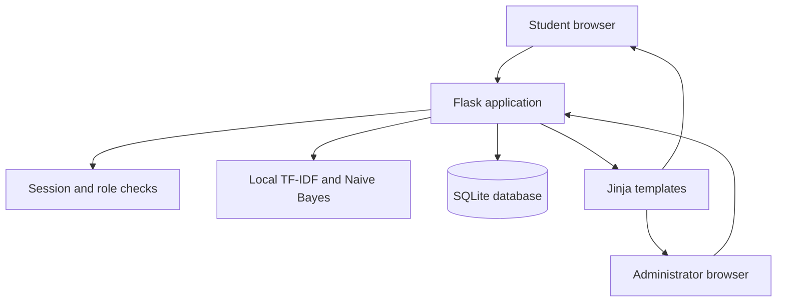
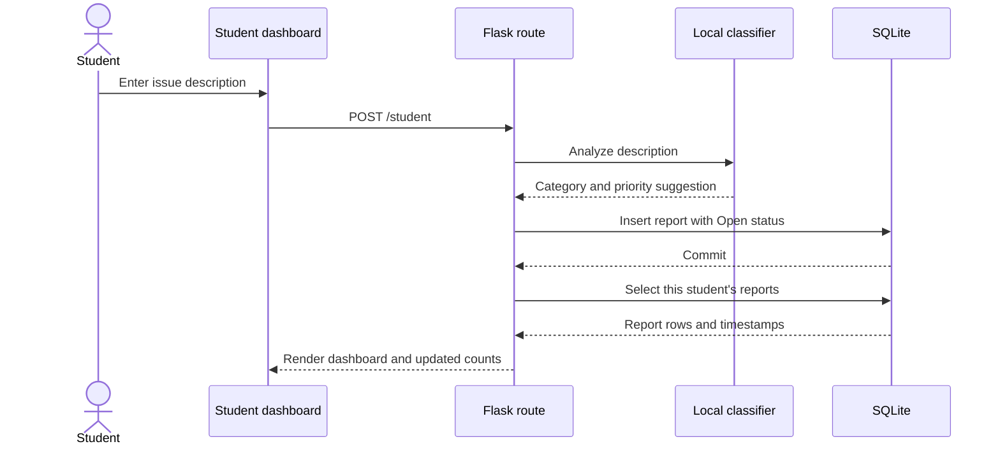
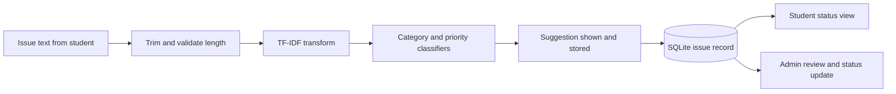
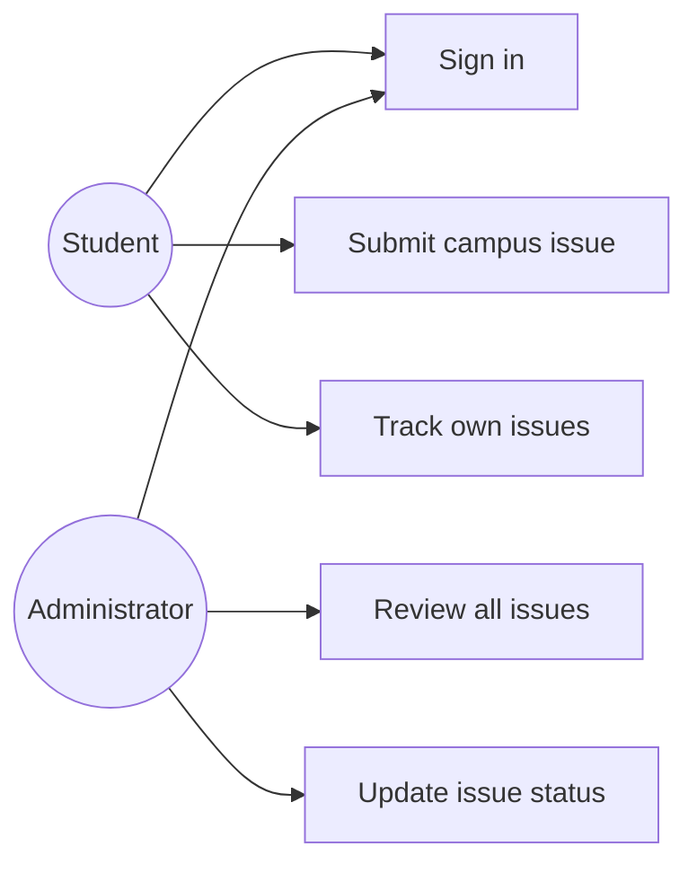
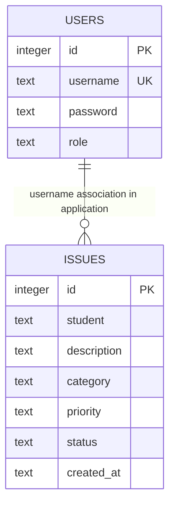

# S Campus Care — Academic Project Report

**Status of statements.** Descriptions of the supplied implementation are marked **Verified**. Design suggestions and capabilities not present in source are marked **Proposed**. The source provides no measured model accuracy, response-time results, survey data, or deployment evidence; this report does not invent them.

## 1. Abstract

S Campus Care is a web-based prototype for recording and tracking campus facility issues. Students submit a text description. A local machine-learning pipeline suggests an issue category and priority, and an administrator can review reports and update their status. The implementation uses Python, Flask, Jinja templates, scikit-learn, and SQLite. This report describes the source-backed design, the initial execution and data-model defects, the repairs made, and the limits of the current classifier. The system demonstrates a low-cost workflow; its small hand-authored training set is not sufficient to establish real-world model performance.

## 2. Introduction

Campus maintenance requests can be difficult to track when they are communicated informally. S Campus Care provides one place to submit an issue and see whether it is open, in progress, or resolved. It is an academic prototype with student and administrator roles.

## 3. Problem statement

The project addresses the lack of a simple, centralized workflow for submitting campus facility complaints and following their status. The source implements issue tracking and classification suggestions; it does not implement a full maintenance-management system, emergency dispatch, or service-level monitoring.

## 4. Objectives

- Provide separate student and administrator sign-in flows.
- Let a student submit and track campus issues.
- Let an administrator review and update all issue statuses.
- Demonstrate local text classification for category and priority suggestions.
- Keep installation and runtime costs low through SQLite and local inference.

## 5. Existing system and 6. Proposed system

**Verified existing system:** one Flask process serves HTML pages; SQLite persists users and reports; two Naive Bayes classifiers run locally. **Proposed improvement:** retain this stack while separating route, database, and model modules; add CSRF protection, account provisioning, schema constraints, and a model review/feedback process. The proposed items are not presented as implemented.

## 7. Related work

The prototype uses standard bag-of-words text features and a probabilistic Naive Bayes classifier. TF–IDF represents terms according to their importance within a text collection; Multinomial Naive Bayes estimates class probabilities from labeled examples. These lightweight methods are commonly used as interpretable text-classification baselines. The present project has no literature comparison or empirical benchmark, so no comparative performance claim is made.

## 8. System requirements

Functional requirements: authenticate by role; submit a report; classify its description; persist it; list a student's own reports; list all reports for an administrator; update a report status; display status counts. Non-functional goals: local operation, low setup cost, understandable output, and preservation of existing reports during schema migration.

## 9. Hardware and software requirements

**Verified execution target:** a computer capable of running Python 3.12, Flask, scikit-learn, and SQLite. The model is small and has no GPU or external API dependency. Exact dependencies and PowerShell startup commands are in `README.md`. No measured minimum RAM, CPU, or latency requirement is available.

## 10. System architecture

The application uses a server-rendered, monolithic architecture. The browser submits forms to Flask. The route applies role checks, invokes local inference for new reports, uses SQLite for persistence, and renders Jinja HTML.

### Component interaction

## 11. Technology stack

| Layer | Technology | Use |
| --- | --- | --- |
| Server | Python 3.12, Flask | Routes, sessions, and HTML response |
| Templates | Jinja, HTML, CSS, small JavaScript | Login and dashboards |
| Data | SQLite | Users and reports in a local file |
| Machine learning | scikit-learn | TF–IDF features and Multinomial Naive Bayes |
| Integrations | None found | No external API or hosted model |

## 12. Module description

The supplied code places database initialization, model training/inference, session checks, and route logic in `app.py`. `login.html` selects a role and submits credentials. `student.html` accepts a description and displays personal reports. `admin.html` displays the full report list and status controls. The database stores user identity/role and issue description/classification/status. This small structure is easy to demonstrate; a larger system should split the modules.

## 13. AI/ML algorithm

The input is the student's issue text. A `TfidfVectorizer` transforms it into a sparse vector of weighted term features. The category `MultinomialNB` predicts one of: IT & Lab Infrastructure, Electrical & Maintenance, Sanitation & Housekeeping, or General Campus Facility. A second `MultinomialNB` predicts Low, Medium, or High priority. The largest category probability is displayed as a percentage. The source maps low-confidence category predictions to a general/low-confidence label and Low priority.

The models are trained from 14 examples embedded in source code whenever the module is imported. They are neither pretrained external models nor API-dependent. No dataset file, training/validation split, accuracy measurement, calibration, or feedback loop exists. The score is a model probability, not validated confidence. Because low confidence forces Low priority, the current rule can understate a serious report. Treat AI output as a suggestion for demonstration and retain administrator review. A future system should use representative, consented, de-identified labels, evaluate per-class precision and recall, and include a human override.

## 14. Dataset and data processing

The source itself contains 14 manually written sentence/category/priority triples. No independent dataset, collection protocol, consent record, or class-balance analysis was found. Processing consists of TF–IDF vectorization and classification. No accuracy or generalization result is reported.

## 15. Methodology

The verified workflow is: initialize SQLite and demo users; accept a role-specific login; collect an issue description; vectorize and classify the text; store the suggestion with the report; render the student view; allow an administrator to set a status. The repair added a timestamp migration, server-side input/status checks, hash-on-success migration for old plaintext passwords, a configurable session key, and a reproducible setup. The regression suite is designed to validate these core interactions.

## 16. System design

### Data flow

### Use cases

## 17. Database design

`created_at` is present after the repair migration. The relationship shown is an application-level username association; the database does not currently enforce it as a foreign key. Password values are stored as hashes for newly seeded accounts and are upgraded on successful login for legacy plaintext records.

## 18. Implementation details

Flask route handlers serve the user interface and write parameterized SQL statements. Passwords use Werkzeug hashing for new records; old plaintext values upgrade after a successful login. The session key can be supplied through `CAMPUSCARE_SECRET_KEY`. SQLite's database path can be overridden through `CAMPUSCARE_DATABASE`. The application uses port 5001. Debug mode is off unless `FLASK_DEBUG=1` is explicitly set.

## 19. User interface

The login page provides student/admin role selection. A student page contains report counts, a multiline issue form, and a table of their reports. The administrator page contains overall counts, all reports, and a status selector. The source includes inline styles and a small script to switch the selected login role.

## 20. Testing and results

The original ZIP contained no automated test suite. This repair adds `tests/test_app.py`. Six Flask test-client tests passed in the Python 3.12.10 environment: login and dashboard access; student report insertion, rendering, and timestamp persistence; invalid description rejection; admin status update and invalid status rejection; migration of a legacy issue table; and upgrade of a legacy plaintext password after successful login. `pip check` found no broken requirements. A separate local HTTP smoke run passed student login, issue submission, admin login, report listing, and status update. Both test methods used temporary SQLite files and did not modify the existing project database. A browser UI and production deployment test were not conducted. These checks validate application flows, not classifier accuracy; no model performance metric is available.

| Test case | Expected result | Actual result | Status |
| --- | --- | --- | --- |
| Student login and dashboard | Authenticated student receives dashboard | HTTP 200 and dashboard content rendered | Pass |
| Submit issue | Row persists; category, priority, status, and date render | Row persisted and expected content rendered | Pass |
| Invalid description | Request rejected; no issue inserted | Error shown; zero rows inserted | Pass |
| Admin status update | Valid status persists; unsupported status has no effect | Resolved persisted; injected value did not replace it | Pass |
| Legacy schema migration | Existing issue remains and receives timestamp | Existing row retained with timestamp | Pass |
| Legacy password upgrade | Existing login works and stored password becomes hashed | Login succeeded and hash prefix verified | Pass |

## 21. Advantages

- Uses a familiar Python web framework and local SQLite file.
- Needs no paid AI service, external API key, or GPU.
- Provides a short end-to-end issue reporting and status workflow.
- Uses a lightweight classifier that is straightforward to explain.

## 22. Limitations

- Fourteen hand-authored examples cannot establish reliable model performance.
- No validated accuracy, model calibration, or operational feedback dataset exists.
- Classification is limited to short text and fixed labels.
- SQLite and a single Flask process suit demonstration scale, not multi-instance production without further design.
- CSRF protection, registration, password reset, notifications, audit logging, and a production identity provider are absent.
- Built-in accounts are demonstration-only and must be replaced before shared deployment.

## 23. Applications and real-world use cases

As a prototype, the workflow can demonstrate reporting facilities issues such as broken equipment, sanitation concerns, and maintenance problems. A real institution would need verified users, staff workflows, escalation policies, data retention controls, and a tested model before relying on classification.

## 24. Future enhancements

1. Add CSRF protection and login throttling.
2. Replace demo-account seeding with administrator-managed account creation.
3. Add database constraints, foreign keys, migrations, backups, and audit history.
4. Gather an approved, de-identified labeled dataset and evaluate against simple baselines.
5. Add manual category/priority correction and use reviewed corrections as candidate training data.
6. Add accessibility review, shared styles, search/filtering, and notifications after core operations are secured.

## 25. Conclusion

S Campus Care already contains the essential shape of a campus issue tracker and a genuine local text-classification pipeline. The audit found a non-portable environment and a mismatch between the student template and database output. The focused repairs address setup reproducibility, rendering/timestamps, input integrity, password storage migration, and debug defaults. The classifier remains an educational suggestion engine; its effectiveness has not been measured and must not be represented as established.

## 26. References

1. Flask documentation, <https://flask.palletsprojects.com/>.
2. scikit-learn user guide, “Feature extraction for text,” <https://scikit-learn.org/stable/modules/feature_extraction.html>.
3. scikit-learn API reference, `MultinomialNB`, <https://scikit-learn.org/stable/modules/generated/sklearn.naive_bayes.MultinomialNB.html>.
4. SQLite documentation, <https://www.sqlite.org/docs.html>.

## Project explanation for presentation

S Campus Care is a campus issue reporting prototype. Students log in, describe a maintenance or facility problem, and track its status. A small local text classifier suggests a category and priority, while an administrator reviews reports and updates progress. It was developed to make campus complaints easier to record and follow. It is inexpensive to demonstrate because it uses Flask, SQLite, and local inference. Its current AI training set is small and has not been evaluated, so predictions are suggestions and need human review. Future work should add stronger security, validated data, model evaluation, and institution-specific workflows.

## Viva questions and answers

1. **What is S Campus Care?** — A web prototype for campus issue reporting and status tracking.
2. **What problem does it address?** — It centralizes reporting and gives students visibility into issue status.
3. **Which language is used?** — Python for the server and model; HTML/CSS/JavaScript for the templates.
4. **Which web framework is used?** — Flask.
5. **What does Flask do here?** — It maps URLs to Python handlers, manages sessions, and renders Jinja templates.
6. **Which database is used?** — SQLite, stored in a local database file.
7. **Why SQLite?** — It avoids a separate database server and is practical for a local academic demo.
8. **What are the two roles?** — Student and administrator.
9. **What can a student do?** — Submit a report and view their own reports and statuses.
10. **What can an administrator do?** — View all reports and change their status.
11. **What statuses are supported?** — Open, In Progress, and Resolved.
12. **What AI algorithm is used?** — TF–IDF text features with Multinomial Naive Bayes classifiers.
13. **What does TF–IDF do?** — It gives words weights based on term frequency and how distinctive they are across the training texts.
14. **Why Multinomial Naive Bayes?** — It is lightweight and commonly used as a text-classification baseline.
15. **What are the model inputs?** — A student-provided issue description converted into TF–IDF features.
16. **What are the outputs?** — A category and a priority suggestion.
17. **Where does training data come from?** — Fourteen manually authored examples embedded in the source code.
18. **Is the model pretrained?** — No. The application fits it from the embedded examples when imported.
19. **Does it use a cloud AI API?** — No external AI service or API was found.
20. **Has model accuracy been measured?** — No; there is no held-out evaluation in the supplied source.
21. **Can the displayed probability be called proven confidence?** — No. It is the classifier's probability output and has not been calibrated.
22. **What is the main AI limitation?** — The training set is very small and may not represent actual campus reports.
23. **How should urgent reports be handled?** — Human review and escalation should override model output; the model is not safety-critical.
24. **How is data persisted?** — Parameterized SQL statements store users and issues in SQLite.
25. **What is a parameterized query?** — SQL with bound values, which keeps input data separate from query syntax.
26. **How are passwords handled after the repair?** — New demo passwords are hashed, and legacy plaintext passwords are upgraded after successful login.
27. **What does the session key protect?** — It signs Flask session cookies against tampering.
28. **Why should debug mode be off in deployment?** — Debug tooling can expose sensitive diagnostic behavior and is intended only for local development.
29. **What bug affected the student dashboard?** — The template expected named fields and a timestamp while the query returned tuples and the original schema lacked the timestamp.
30. **How is the schema repaired?** — Startup adds the missing timestamp column and fills existing rows without deleting reports.
31. **What tests were added?** — Tests for login, submission, rendering, persistence, validation, admin status changes, and legacy schema migration.
32. **What is a limitation of SQLite for scale?** — It is best for a small single-host prototype; concurrent multi-instance deployment needs additional data-layer planning.
33. **What is a foreign key?** — A database constraint that ensures a reference points to an existing row; the current username association is not enforced as one.
34. **What is CSRF?** — Cross-site request forgery, where a user’s browser can be tricked into submitting an unwanted action; tokens should be added before networked deployment.
35. **What is the next practical AI step?** — Collect reviewed, de-identified labeled examples and evaluate per-class precision and recall against a baseline.
36. **What is precision?** — Of the items predicted as a class, the fraction that truly belong to that class.
37. **What is recall?** — Of the true items in a class, the fraction the classifier identifies.
38. **Why report per-class metrics?** — Aggregate scores can hide poor performance on rare but important categories.
39. **What environment does the project need?** — Python 3.12 and the packages listed in `requirements.txt`; SQLite is included with Python.
40. **Which port does the app use?** — Port 5001, as configured in `app.py`.
