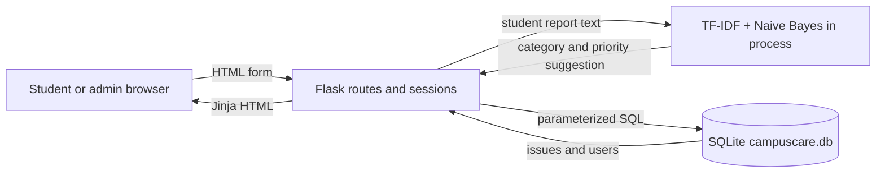

# S Campus Care — Project Audit and Reconnaissance

**Audit scope:** source and configuration present in the supplied `Campus Care.zip` and working checkout. The repository contains three application templates, one Flask module, and one SQLite database. Existing uncommitted edits were present in `app.py`, `campuscare.db`, and all three templates before this audit; those changes were retained. No claim below treats a proposed capability as implemented.

## 1. Executive summary

S Campus Care is a single-process, server-rendered campus issue tracker. A student signs in, submits a text description, and receives a category and priority suggestion. An administrator sees all submissions and can change status. Flask handles routes and HTML rendering, SQLite persists users and issues, and scikit-learn runs a small text classifier in-process. This is a coherent academic prototype with a complete core workflow, but its environment is not portable, its student dashboard had a template/database mismatch, and the AI training corpus is too small for reliable operational triage.

## 2. Verified technology stack

| Area | Evidence | Finding |
| --- | --- | --- |
| Language | `app.py` | Python |
| Web framework | `from flask import ...` | Flask; server-rendered Jinja templates |
| Machine learning | `TfidfVectorizer`, `MultinomialNB` in `app.py` | scikit-learn, in-process supervised text classification |
| Database | `sqlite3.connect` and `campuscare.db` | SQLite; no external database server |
| Front end | `templates/login.html`, `student.html`, `admin.html` | HTML, inline CSS, Jinja, small role-selection JavaScript |
| External services | No integration code found | None found; no API keys required |
| Authentication | `users` table and Flask session | Username/password and role; no external identity service |
| Bundled environment | ZIP `.venv/pyvenv.cfg` | Python 3.15.2, Flask 3.1.3, scikit-learn 1.9.1 among installed distributions; absolute interpreter path refers to a missing `C:\Python315\python.exe` |
| Dependency manifest | ZIP listing | No `requirements.txt`, `pyproject.toml`, or equivalent was present |

The workspace's system Python 3.12.10 did not have Flask or scikit-learn installed. The bundled venv could not launch because its recorded base interpreter is missing. Thus application execution was initially blocked by environment setup, not by an observed application traceback.

## 3. Directory and module breakdown

```text
Campus Care/
├── app.py                 Flask routes, classifier, and SQLite initialization
├── campuscare.db          Existing users and issue records (SQLite)
├── templates/
│   ├── login.html         Role selection and login form
│   ├── student.html       Student report form, counts, and report table
│   └── admin.html         All reports, counts, and status update forms
└── .venv/                Bundled non-portable virtual environment
```

No static asset directory, migration framework, model artifact, API module, formal test suite, or source documentation was found in the ZIP. The application trains the classifier in memory during import; there is no serialized model file.

## 4. Execution flow and feature inventory

1. Running `python app.py` initializes tables and demonstration users, trains the two classifiers from embedded examples, and starts Flask on port 5001.
2. `GET /` renders login. `POST /` checks username, password, and selected role, then sets session fields.
3. `GET/POST /student` checks the student role. A POST classifies the description, inserts an issue, then queries the signed-in student's reports.
4. `GET /admin` checks the admin role and renders all issues.
5. `POST /update_issue/<id>` checks the admin role and updates an issue status.
6. `GET /logout` clears the session.

| Feature | Source implementation | Audit result |
| --- | --- | --- |
| Student/admin login | `/`, `users`, Flask session | Implemented; original password storage was plaintext; login migrated to hash-on-success in this repair |
| Report issue | `/student` POST | Implemented; text classification and SQLite insert connected |
| Student report list and counts | `/student` query and `student.html` | Previously broken by tuple-vs-named-field mismatch; corrected and covered by regression test |
| Admin list and counts | `/admin` query and `admin.html` | Implemented; existing positional template access is retained |
| Status changes | `/update_issue/<id>` | Implemented; accepted values now restricted to the three displayed options |
| Timestamps | Template expected `created_at`; original schema lacked it | Missing in original schema; migration and default timestamp added |
| REST API | No API routes found | Not implemented |
| Notifications, attachments, search, user registration | No source found | Not implemented |
| AI inference | In-memory model called during issue submission | Functional for a demonstration; model quality is unvalidated and corpus is only 14 hand-written examples |

## 5. Database design

The verified original schema has `users(id, username UNIQUE, password, role)` and `issues(id, student, description, category, priority, status)`. The bundled database contained two demonstration issue rows and the seeded admin and student accounts. `student` is stored as a username string rather than a foreign key. There are no constraints for valid roles, priorities, or statuses and no declared relationship between the tables. The repair adds `issues.created_at` using a non-destructive, in-place migration; existing rows are retained and receive a migration timestamp.

## 6. Existing AI/ML analysis

The source embeds 14 labeled issue-description examples. `TfidfVectorizer` converts words into TF–IDF features. One `MultinomialNB` predicts one of four categories; a second predicts one of three priority labels. The category model's largest class probability is displayed as confidence, and predictions below 30% are mapped to a general/low-confidence category and low priority.

This is actual model fitting and inference, not a placeholder or remote API. However, the examples are few, manually authored, not representative of validated campus reports, and no train/test split or measured accuracy exists. Naive Bayes probability is not calibrated confidence. A low-confidence category can still suppress a real safety hazard by forcing Low priority. It is suitable as a transparent demonstration suggestion, not as a safety-critical decision. Staff must review the result; urgent reports should be escalated independently of the model. A practical next version should collect consented, de-identified labeled reports, compare a rules baseline with TF–IDF plus Naive Bayes using a held-out split, measure per-class precision/recall, and allow human correction. Until that dataset exists, present the output as a suggestion and retain manual review.

## 7. Initial execution feasibility

The application is feasible to run locally on a student computer after installing Python dependencies. SQLite needs no service setup and the model needs no external key or GPU. Port 5001 is specified in `app.py`. The original project had no dependency manifest and bundled a venv tied to a different computer. This audit adds `requirements.txt` and a PowerShell setup guide in `README.md`. Exact startup instructions and limitations are documented there.

## 8. Issue register

| ID | Severity | Evidence and root cause | Resolution / next action |
| --- | --- | --- | --- |
| A-01 | Critical (environment) | Bundled venv points at missing `C:\Python315\python.exe`; host Python 3.12 had no Flask or scikit-learn. No dependency manifest. | Added pinned dependencies and documented a fresh Python 3.12 environment. SciPy 1.18.1 hit a Windows Application Control block for `_propack`; pinning SciPy 1.15.3 avoided it. `pip check` and the app tests pass in the clean Python 3.12 environment. |
| A-02 | High (student UI) | `student.html` accessed `issue.id`, `.description`, and `.created_at`, while `SELECT *` returned tuples and the schema had no timestamp. | SQLite rows expose column names and tuple indexes; migration adds `created_at`. Regression test covers rendering and persisted timestamp; passed. |
| A-03 | High (credential security) | `app.py` stored and compared raw passwords and used a fixed session signing secret. | Passwords hash for new accounts and old accounts upgrade after successful login; key now comes from environment or a per-process random value. Set a stable key for persistent sessions. |
| A-04 | High (debug exposure) | Original startup forced `debug=True`. | Debug is off by default and enabled only with `FLASK_DEBUG=1`. |
| A-05 | Medium (input integrity) | Server accepted arbitrary description lengths and status values despite constrained UI choices. | Added server-side description and status validation. CSRF protection remains an improvement for any networked deployment. |
| A-06 | Medium (AI reliability) | 14 training samples; no model evaluation, dataset provenance, feedback, or calibrated confidence. | Documented as a demonstration only. Collect representative reviewed data and evaluate before operational use. |
| A-07 | Low (maintainability) | Route, persistence, and ML concerns live in one module; inline styles duplicate page concerns. | Keep current structure for this small prototype; split into service modules and shared assets if features grow. |
| A-08 | Low (data model) | `student` is a username string without foreign key; status/priority values have no database constraints. | Add explicit relationships and constraints alongside a planned schema migration if registration or account editing is added. |

## 9. Architecture assessment and recommendation

The current single-process architecture is appropriate for a classroom demonstration: browser → Flask route/Jinja → local SQLite; the issue route also calls the local classifier. Its simplicity keeps installation cost low. The principal weaknesses are mixed responsibilities, hard-coded demonstration account provisioning, lack of CSRF protection, and limited AI validation.

Recommended next architecture: retain Flask and SQLite; isolate route handling, database access/migrations, and classifier logic into small Python modules; use parameterized queries, password hashes, server-side validation, CSRF protection, and environment configuration; keep the model local and return a suggestion plus an uncertainty indicator; require human review for urgent/high-risk cases. A production deployment should add managed secrets, HTTPS, backups, authorization tests, and a supported WSGI server. Those deployment pieces are proposals, not existing capabilities.



## 10. Prioritized roadmap

1. **Execution and core workflow:** install from the manifest, initialize/migrate SQLite, verify login, submit, listing, status update, and logout. (Current repair and validation.)
2. **Security:** CSRF tokens, rate limits for login, configurable demo-account provisioning, session expiry policy, HTTPS and production server guidance.
3. **AI evidence:** gather reviewed de-identified examples; define label guide; compare simple baselines; report per-class metrics and failure cases; keep human override.
4. **Maintainability:** separate persistence, classifier, and routes; add schema versioning and database constraints.
5. **Academic demonstration:** explain verified behavior separately from proposed capabilities; avoid accuracy claims until measured.

## Assessment requested

- **Successfully developed:** student/admin sign-in, issue submission, local classification suggestion, SQLite persistence, student tracking, admin-wide review, status updates, and counts.
- **Broken in the supplied working tree:** student issue rendering was out of sync with query rows and schema; the bundled interpreter environment could not start.
- **Incomplete:** dependable AI evaluation, secure deployment controls, schema relationships/constraints, CSRF prevention, robust automated coverage (now initiated), and user-facing setup documentation.
- **Needs architectural improvement:** separate concerns as the project grows, improve data integrity and security, and make model confidence/use explicit.
- **Practical route:** keep Flask/SQLite, establish a clean Python 3.12 environment, fix and verify the existing workflow, then add security and data-backed AI improvements in small migrations.

## Validation completed

The clean Python 3.12.10 environment installed Flask 3.1.3, scikit-learn 1.9.1, and SciPy 1.15.3. `pip check` reported no broken requirements. Six Flask test-client tests passed against temporary SQLite databases: login/dashboard, student issue insertion and rendered fields/date, invalid description rejection, admin status update and invalid status rejection, legacy timestamp migration, and legacy password hash upgrade. A local HTTP smoke run also passed student login, report submission, admin login, report listing, and status update using a separate temporary database. The repository's existing `campuscare.db` was not used. No browser UI or production deployment test was run.
